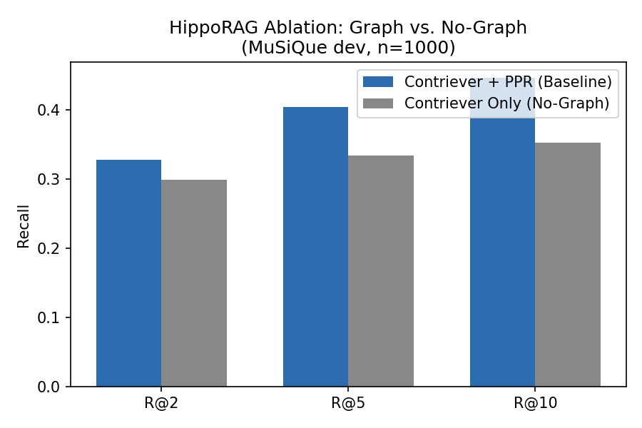

# HippoRAG Ablation: Graph vs. No-Graph Retrieval on MuSiQue

Controlled ablation study isolating the contribution of Personalized
PageRank (PPR) graph reasoning in [HippoRAG](https://github.com/OSU-NLP-Group/HippoRAG)
(Jiménez Gutiérrez et al., NeurIPS 2024) on the MuSiQue multi-hop QA benchmark.

📄 **[Read the full paper →](./paper.md)**

## Key Finding

On this setup (MuSiQue dev, n=1,000, Contriever), removing PPR graph reasoning
lowers Recall@10 from 0.4467 to 0.3528: **−9.4 points absolute (−21.02% relative)**.
A paired bootstrap over the 1,000 queries gives a 95% CI of [+0.082, +0.106] for
the R@10 gain from PPR (see `results/bootstrap_ci.txt`). This is one run on one
dataset with one encoder, so it supports, but does not by itself establish, that
graph reasoning is the main driver of HippoRAG's gains.

## Results (n=1,000 queries, MuSiQue dev)

| Metric | Contriever + PPR (Baseline) | Contriever Only (Variant) | Δ |
|--------|------------------------------|------------------------------|---|
| R@2    | 0.3276                       | 0.2995                       | −8.58% |
| R@5    | 0.4037                       | 0.3344                       | −17.17% |
| R@10   | 0.4467                       | 0.3528                       | −21.02% |



## Repository Structure

```
hipporag-graph-ablation/
├── README.md               # this file
├── paper.md                 # full write-up (abstract, method, related work, analysis)
├── compute_recall.py         # recomputes Recall@k and regenerates the chart
├── bootstrap_ci.py           # paired bootstrap CIs from stored results
├── requirements.txt
└── results/
    ├── baseline_ppr.json         # per-query results, Contriever + PPR
    ├── variant_no_graph.json     # per-query results, Contriever only
    ├── bootstrap_ci.txt          # paired bootstrap CIs (from bootstrap_ci.py)
    └── comparison_chart.png      # generated bar chart
```

## How to Reproduce

```bash
git clone https://github.com/malahilghauri-design/hipporag-graph-ablation.git
cd hipporag-graph-ablation
pip install -r requirements.txt
python compute_recall.py
```

This recomputes Recall@2/5/10 directly from the stored per-query result files
and regenerates `results/comparison_chart.png`.

```
python bootstrap_ci.py
```

This computes paired bootstrap confidence intervals from the same stored files
and writes `results/bootstrap_ci.txt`.

**What this does and does not verify.** Both scripts only read the saved
per-query results. They check the arithmetic of the reported scores. They do
not re-run indexing or retrieval, so they cannot independently verify the
retrieval experiment itself.

## Scope and Limitations

- Single run, single dataset (MuSiQue dev), single encoder (Contriever); no
  seed or hyperparameter variation.
- The generation script and run configuration behind the two JSON files are
  not in this repo. See Provenance below.
- Percent drops in the table are relative; absolute differences are in
  `results/bootstrap_ci.txt`.

## Provenance

- Retrieval run: [ADD Kaggle notebook link, or write: "Not available. The JSON
  files come from an earlier run and no configuration was saved."]
- Based on HippoRAG's original pipeline and code (OSU-NLP-Group). My
  contribution: [ADD what you actually did, e.g. Python 3.12 patches, running
  the two configurations, `compute_recall.py`, `bootstrap_ci.py`, paper.md].

## Citation

Built on top of [HippoRAG](https://github.com/OSU-NLP-Group/HippoRAG) (NeurIPS 2024):

> Jiménez Gutiérrez, B., et al. (2024). *HippoRAG: Neurobiologically Inspired
> Long-Term Memory for Large Language Models.* NeurIPS 2024.
